<!-- Generated by scripts/build.mjs. Edit profile.json instead; the workflow rebuilds this file. -->


 <a href="https://github.com/Yuwr1d4g0at/Yuwr1d4g0at/issues/new?title=%5BPET%5D%20the%20goat&body=Click%20**Submit%20new%20issue**%20to%20pet%20the%20goat!%20%3A3%0A%0AThis%20closes%20by%20itself%20in%20a%20minute%20or%20two%2C%20and%20the%20profile%20updates.">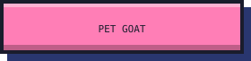</a> <a href="https://github.com/Yuwr1d4g0at/Yuwr1d4g0at/issues/new?title=%5BATTACK%5D%20the%20bug%20boss&body=Click%20**Submit%20new%20issue**%20to%20attack%20the%20bug%20boss!%0A%0AThis%20closes%20by%20itself%20in%20a%20minute%20or%20two%2C%20and%20the%20profile%20updates.">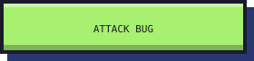</a>

[my website](https://github.com/Yuwr1d4g0at/IT-Help-website) · [ask me for IT help](https://github.com/Yuwr1d4g0at/Yuwr1d4g0at/issues/new?template=it-help.yml) · [sign the guestbook](https://github.com/Yuwr1d4g0at/Yuwr1d4g0at/issues/new?template=guestbook.yml)

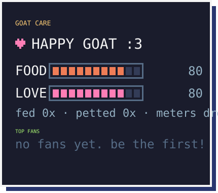 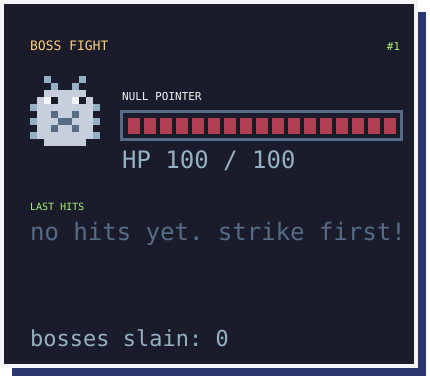


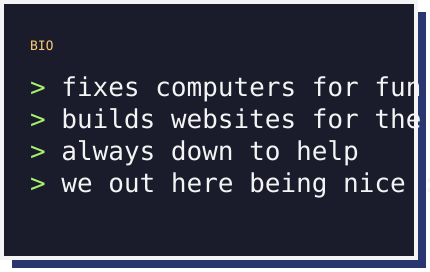 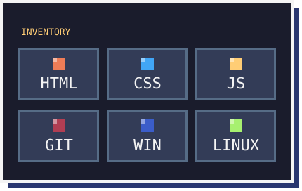

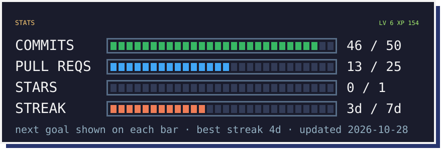

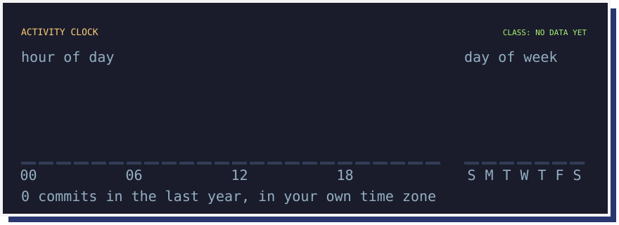

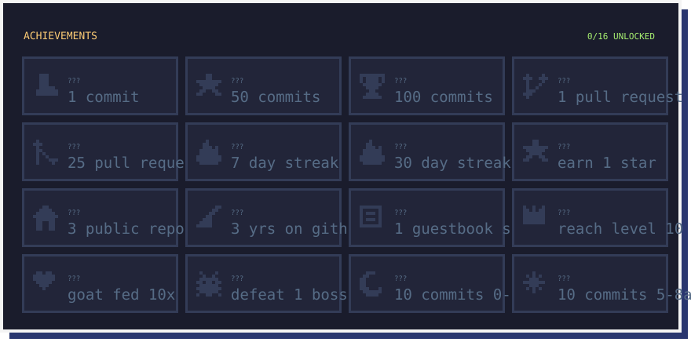

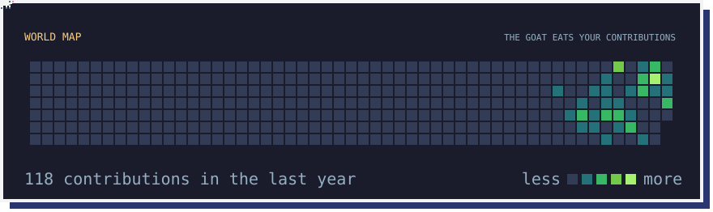

<a href="https://github.com/Yuwr1d4g0at?tab=repositories">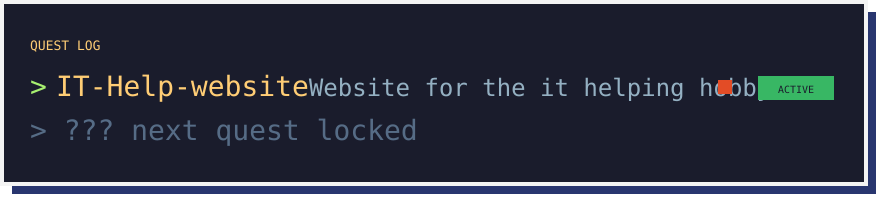</a>

[IT-Help-website](https://github.com/Yuwr1d4g0at/IT-Help-website)

<a href="https://github.com/Yuwr1d4g0at/Yuwr1d4g0at/issues/new?template=guestbook.yml">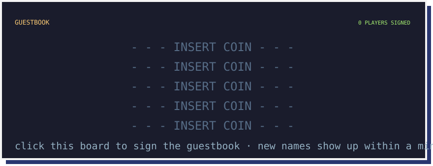</a>

